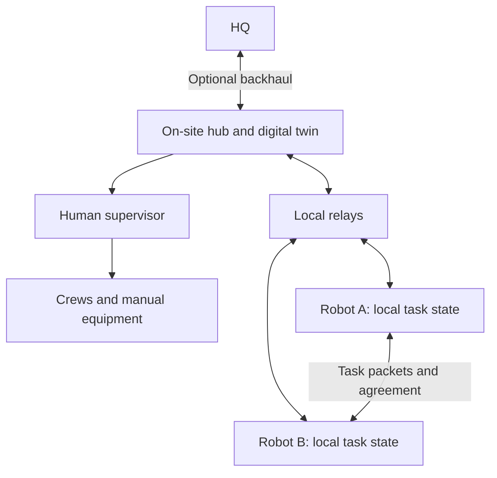

# MITEC-2026
Two twos

## Exowatt challenge: off-grid build-site digital twin

```
frontend/        build manager console (React + Electron): map, state panel, chat with the site agent
services/edge/   edge service (Python): survey, buildup planner, construction twin, site mesh, monitor, Claude site agent
tools/terrain/   fetches real elevation data for the site
```

## The Problem

Exowatt's modular P3 deployments may involve thousands of units at rural sites without reliable cellular or internet coverage. Survey robots, construction machines and workers share an environment that changes as construction progresses. Delayed information can leave supervisors with stale positions or task status, increasing coordination effort and waiting.

The project aims to support local communication, clear task ownership, worker awareness and adaptation to changing links and work zones.

## Current scope

| Area | Status |
|---|---|
| Site model, noisy localization and delayed task reports | Illustrated by supplied software simulation output |
| Packet-driven robot messaging and emulated bidding/agreement | Defined as the digital twin's next implementation target |
| Production task allocation and replicated ownership | Proposed CBAA-inspired design |
| Encrypted binary messages and application routing | Proposed protocol specification |
| Physical radios, worker tags and machine safety integration | Future hardware integration and field validation |
| Pilot costs, schedule and performance targets | Illustrative planning assumptions |

The prototype is software-only. The existing plots do not establish field radio performance, working production consensus, certified collision prevention or measured productivity savings.

## System architecture



- **Hub:** publishes authorized tasks, separates manual and robot work, and displays reports as they arrive. Headquarters access is optional for local coordination.
- **Supervisor and crews:** manage manual work, review progress and intervene when necessary.
- **Relays:** forward messages across the site. They do not choose task winners.
- **Robots:** maintain local task knowledge, exchange bids and agreement messages, and execute authorized assignments subject to local checks.
- **Digital twin:** displays site activity, network conditions, task states and the age of reported information.

## Mesh communication

Each robot or relay communicates with its reachable neighbors. Forwarding lets a task announcement reach robots outside the sender's direct range. If a link fails, an alternative connected route may carry the message. A partition with no alternative route still interrupts delivery.

This supports wider coverage, less dependence on the hub and relocation of relays as work zones change. It does not automatically guarantee delivery, low latency or unlimited fleet size. Hop limits, duplicate filtering, bounded queues and retries are part of the design.

ESP-NOW is a candidate for a small ESP32 hardware demonstration, with application-level forwarding. Field-scale transport remains an engineering decision requiring radio surveys and load testing. Bulk maps or video should use a suitable separate data channel rather than crowding the control messages.

## Task allocation: proposed deployment design

The design is **CBAA-inspired**, referring to the Consensus-Based Auction Algorithm. Each robot has at most one active assignment. CBBA instead plans bundles of multiple tasks. This project proposes custom extensions rather than claiming a literal implementation of either published algorithm.

1. An authorized source publishes a task with an ID, revision, location, priority and requirements.
2. Available robots check capability, battery reserve and safe access, then submit fixed suitability scores. Bids represent suitability, not spendable currency.
3. Robots exchange bids and use the same accepted input snapshot and scoring rules. Task priority orders the work; robot IDs resolve equal scores.
4. A robot-hosted ownership registry reserves the selected robot or complete required team after readiness checks.
5. A committed assignment permits execution after onboard checks. The hub receives the record asynchronously and does not approve every start.

The production proposal uses a proven replicated consensus implementation, such as Raft, with a fixed robot voter set. Five configured voters require three for new commits. A temporarily elected robot leader orders registry updates. This is hub-independent, with explicit leadership and membership rules.

Missing heartbeats do not release ownership. Reassignment requires confirmed stopping/release or enforceable fencing. Higher-priority work requires a controlled handover. Multi-robot work needs an all-or-nothing team reservation plus any necessary physical coordination.

## Digital twin: simplified bidding and agreement

**The twin emulates allocation. It does not reproduce the full bidding algorithm, production registry or consensus firmware one-to-one.** Its central demonstration is that robots receive task packets, exchange information and converge on an owner before simulated execution begins.

Represent neighbor links, delivery delay, packet loss and separate robot inboxes explicitly. Receiving a packet changes that robot's knowledge. The simulator's global rendering state must not silently supply bids or tasks to every robot.

| Emulator message | Purpose |
|---|---|
| `TASK_ANNOUNCE` | Task details, revision, round and fixed participants |
| `BID` | One frozen illustrative score, or an explicit decline |
| `AGREE` | Proposed winner and fingerprint of the complete bid set |
| `COMMIT` | Agreed owner and idempotent assignment ID |
| `STATUS` | Progress, completion, blockage or confirmed release |
| `HEARTBEAT` | Optional availability information |

For the initial emulator, handle one allocation round at a time and one active task per robot. Use a repeatable score such as `100 - travel_penalty - energy_penalty`, with eligibility checked separately. Each fixed participant must receive every participant's bid or decline before proposing a winner. The tentative winner waits for matching agreement records from all participants before an abstract component records one commit.

This deliberately conservative unanimity rule is **specific to the emulator**. The proposed production registry uses majority-based replicated consensus. Do not substitute the emulator for that protocol.

Missing packets leave agreement pending. Do not shrink the participant set to force a winner. Retries, duplicate suppression and task/round revision checks prevent repeated effects. After commitment, loss of contact marks ownership uncertain rather than freeing the task.

### Suggested demonstration

Show A reaching C through B. Let illustrative bids be A: 72, B: 86 and C: 64. After the full bid set and matching agreement messages arrive, B commits and starts. Break the relay path before agreement to show a pending round, then restore delivery. Turn off the hub after task delivery to demonstrate connected robots continuing their exchange.

Display task states such as Announced, Bidding, Awaiting agreement, Assigned, In progress and Completed. Label the mode **Emulated bidding and consensus**. A packet animation alone is not delivery evidence.

## Worker safety

The proposed field stack combines worker identity/proximity information with independent local protective sensing and control.

| Layer | Intended role |
|---|---|
| UWB worker badge | Worker identity and robot-to-badge ranging |
| Outdoor safety LiDAR | Detect occupied space independently of a working badge |
| Camera | Recognize people and support navigation, subject to performance checks |
| Local safety controller | Apply machine-specific slowing or stopping on the robot |

Network warnings supplement these layers. Protective action must not wait for the hub, an auction or a mesh message. Steel, occlusion, dust, sensor failure and stopping distance require field evaluation. Tags and a digital twin are awareness inputs, not a validated collision-prevention system by themselves.

## Packet security

The proposed wire protocol separates mutable forwarding information from an authenticated original message. It includes routing metadata, an immutable header, an encrypted body, an AES-CCM authentication tag and an Ed25519 sender signature. Identity, boot/sequence counters and task versions support replay and stale-message handling.

The proposed compact profile allows a 250-byte application packet, with up to 144 body bytes after its 106-byte overhead. These are specification limits, not throughput measurements. ESP-NOW still requires the application forwarding layer.

Forward-only relays can operate without body-decryption keys. Authentication does not prevent radio jamming or every compromised-device failure. A delivery receipt, an agreement message and permission to move are separate events. The emulator may use structured objects and keep cryptography abstract.

## What the supplied simulation shows

- At approximately **898 seconds**, **30 tasks** were actually complete while the hub had reports for **29**. This illustrates stale visibility in one simulated scenario.
- Filtered position estimates often remain around a few tenths of a meter, but error spikes exceed **1 meter**. Filtering does not eliminate uncertainty.

These results motivate timestamped reports, uncertainty-aware displays and explicit ownership. They do not establish auction performance, real radio reliability or safety certification. No new aggregate error statistic was calculated without the raw dataset.

## Illustrative implementation plan

**All figures below are dummy planning assumptions, not vendor quotes, actual spending or achieved results.** Scope: one work zone, five existing robots, two relays, ten badges and six positioning anchors.

| Item | Example cost |
|---|---:|
| Seven radio nodes at $80 | $560 |
| Ten worker badges at $60 | $600 |
| Six positioning anchors at $150 | $900 |
| Sensing and stop-interface allowance | $8,000 |
| 120 engineering hours at $50 | $6,000 |
| Subtotal | $16,060 |
| 20% contingency | $3,212 |
| **Total** | **$19,272** |

Robot purchases, formal certification, taxes, ongoing operations and optional backhaul subscriptions are excluded. Existing robots and a laptop are assumed available.

| Proposed phase | Work |
|---|---|
| Weeks 1-2 | Map hazards, survey coverage, confirm task data and robot interfaces |
| Weeks 3-5 | Integrate messaging, positioning and local stop interfaces |
| Weeks 6-8 | Run a supervised trial and measure reporting delay, task conflicts and waiting |

Required inputs include a site map, task definitions, robot API access and timestamped logs. Exowatt's site lead and crews adopt the operating procedures, the software team develops the twin, and a robotics integrator connects hardware. RF compliance, worker privacy, machine safety, procurement and site access constrain deployment.

## Next steps and example acceptance targets

1. Implement per-robot inboxes, neighbor-limited delivery and visible packet-driven agreement with abstract bid scoring.
2. Run seeded delay, loss, stale-message, relay-failure, restart and hub-outage scenarios. Record both consistency and stalled-round behavior.
3. Bench-test three radios, then evaluate a supervised five-robot pilot with independently validated local stop behavior.
4. Compare equivalent work against a manual-dispatch baseline before estimating operational value.

| Example target | Meaning |
|---|---|
| Zero conflicting owners across 100 emulated runs | A test target, not a proof of production correctness |
| At least 95% of routine updates delivered within two seconds | A proposed target under defined nominal pilot conditions |
| 10% less coordination waiting | A proposed comparison against an equivalent manual baseline |

None of these targets has been demonstrated by the supplied results. Keep the emulator's behavior, production design and measured evidence clearly identified as the project develops.

## Project documents

- [Submission deck](https://chatgpt.com/library?file_id=libfile_97704313494c81918e5ca4cd14211d4d&account_id=personal) and [submission PDF](https://chatgpt.com/library?file_id=libfile_09b25c1c92c48191a65639316ee0135b&account_id=personal): ten main slides and one appendix.
- [Mesh network and digital twin summary](https://chatgpt.com/library?file_id=libfile_a273ca0b83688191a647727fbd008528&account_id=personal): current emulator behavior and acceptance checks.
- [Distributed CBAA guide](https://chatgpt.com/library?file_id=libfile_59f7bd102f3c8191863b9a3c39c6fcc3&account_id=personal): proposed deployment allocation and registry behavior.
- [Mesh packet design v1](https://chatgpt.com/library?file_id=libfile_0911fa9afaf88191b2d42ec3ba8fe90f&account_id=personal): proposed binary packet layout, security and transport considerations.
- [Editable initial-plan diagram](https://chatgpt.com/library?file_id=libfile_a848a9bedea4819181727df1cc7b3a07&account_id=personal): recreation of the original architecture sketch. Use the newer documents above for the emulator and production allocation rules.


